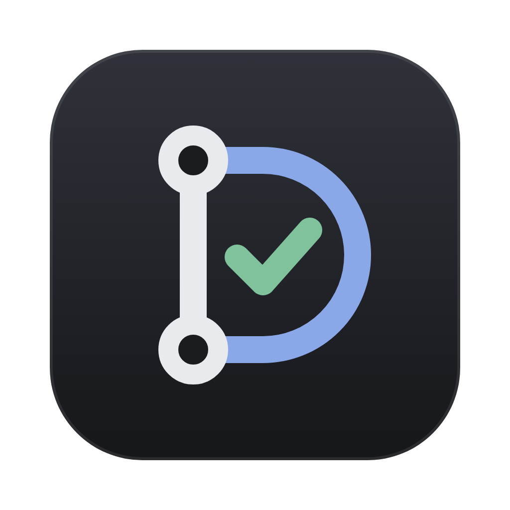

<p align="center"></p>

# Docket

A desktop dashboard for the pull requests that need you, with code reviews drafted by Claude.

Docket reads your GitHub pull requests, sorts them by what is waiting on you, and lets you review them without leaving the app. When you open a pull request you can ask Claude to draft a review; you edit the draft, choose which comments to keep, and post it to GitHub as your own review.

It runs entirely on your machine. It uses the GitHub CLI and Claude Code you are already signed in to, so there are no tokens to paste and no server in between.

## What it does

### Dashboard

- **Two columns.** Your own pull requests on the left, pull requests waiting for your review on the right.
- **Sorted by what needs you.** Each row says why it is there: changes requested, checks failing, ready to merge, waiting on a reviewer.
- **Status at a glance.** Review state, CI, mergeability and your own review draft line up in fixed columns from row to row.
- **CI detail.** Failing checks are named on the row. Docket tells required checks from optional ones, so "failing but can still merge" is shown differently from "merge blocked".
- **Stacks.** Pull requests that build on each other's branches are grouped in merge order.
- **Filters.** Search, repository, attention level, CI state, authors (multi-select), drafts, reviews you are drafting, pull requests you already reviewed, and pull requests with a video or screenshots in the description.
- **Pins.** Keep any pull request at the top of either column.
- **Notifications.** A dock badge counts what needs you, and a notification appears when something new does.

### Pull request page

- **Diff viewer** with syntax highlighting, a file tree, and GitHub-style "Viewed" checkboxes that are remembered per pull request.
- **Existing comments** from GitHub shown inline on the lines they belong to, with a count on each file even when it is collapsed.
- **Description** rendered as on GitHub, including attached videos and images.
- **Why CI failed.** Each failed GitHub Actions job can show the log lines around its first error.
- **Your review status.** A clear badge says whether you already approved, requested changes, commented, or have not reviewed.

### Reviews drafted by Claude

- **Full context.** Docket checks the pull request out into a local clone so Claude can read the surrounding code, not only the diff. If the checkout fails it falls back to the diff.
- **Focus.** Tell Claude what to look at before it starts, or on a rerun.
- **Model, effort and verbosity** can be chosen per review, with your Claude Code defaults shown.
- **Editable draft.** A summary, a verdict, and line comments graded as blocker, issue, suggestion, nit or question. Edit any of them, add your own, and untick the ones you do not want posted.
- **Nothing is posted until you post it.** Drafts are saved locally and marked stale when new commits arrive.

### Reviewer voice

Under Settings you can describe how you write review comments, or have Docket learn it from your recent GitHub review comments. The guide is given to Claude with every review so the drafts sound like you. It is plain text and fully editable.

### Performance

Your merged pull requests, reviews given, review response time and commits, by week or by month, for all repositories or one.

## Install

1. Open the [latest release](https://github.com/niko-cxvedadze/docket/releases/latest) and download the `.dmg` for your Mac:
   - `Docket-<version>-arm64.dmg` for Apple silicon (M1 and later)
   - `Docket-<version>-x64.dmg` for Intel
2. Open the `.dmg` and drag Docket into Applications.
3. Docket is not notarised by Apple, so macOS blocks it the first time. Clear the download flag once and it opens normally:

   ```sh
   xattr -cr /Applications/Docket.app
   ```

   Or try to open it, then go to System Settings → Privacy & Security and choose **Open Anyway**.

Docket needs two tools you sign in to yourself:

- [GitHub CLI](https://cli.github.com), signed in: `gh auth login`
- [Claude Code](https://claude.com/claude-code), signed in. Only needed for drafting reviews and learning your voice; the dashboard works without it.

It is built and tested on macOS only.

## Development

You need [Node.js](https://nodejs.org) 22 or newer, [pnpm](https://pnpm.io) and `git`, plus the two tools above.

```sh
git clone https://github.com/niko-cxvedadze/docket.git
cd docket
pnpm install
pnpm dev
```

| Command | What it does |
| --- | --- |
| `pnpm dev` | Run the app with hot reload |
| `pnpm build` | Compile into `out/` |
| `pnpm start` | Run the compiled app |
| `pnpm dist` | Build the installable app into `dist/` |
| `pnpm typecheck` | Type-check the project |

## Building and releasing

### Build the app locally

```sh
pnpm dist
```

This writes to `dist/`:

- `Docket-<version>-arm64.dmg` and `Docket-<version>-x64.dmg`, the installers
- matching `.zip` files
- `mac-arm64/Docket.app` and `mac/Docket.app`, the app itself, which you can run or copy to Applications directly

### Publish a release

Releases are built by GitHub Actions ([release.yml](.github/workflows/release.yml)) whenever a version tag is pushed:

1. Set the new version in `package.json`, for example `0.2.0`, and commit it.
2. Tag that commit and push:

   ```sh
   git tag v0.2.0
   git push origin master --tags
   ```

3. The workflow builds both installers and publishes them on the [releases page](https://github.com/niko-cxvedadze/docket/releases) with generated notes. It takes a few minutes. The tag must match the version in `package.json`.

To upload a build you already made locally instead:

```sh
gh release create v0.2.0 dist/*.dmg dist/*.zip --title "Docket 0.2.0" --generate-notes
```

The app is signed ad hoc, not with an Apple Developer ID, which is why users need the one-time step under Install. The icon sources are in `build/` (`icon.svg` is the original).

## Keyboard

On a focused dashboard row:

| Key | Action |
| --- | --- |
| `Enter` / `Space` | Open the pull request |
| `O` | Open it on GitHub |
| `P` | Pin or unpin |
| `X` | Select |
| `Esc` | Clear the selection |

In the review panel, `Cmd+Enter` starts the review.

## How it works

Docket is an Electron app built with [electron-vite](https://electron-vite.org), React 19, Tailwind CSS v4 and [shadcn/ui](https://ui.shadcn.com).

```
src/
  main/       Electron main process: GitHub, Claude, local storage
  preload/    The typed bridge exposed to the window as window.api
  renderer/   The React app
  shared/     Types shared by all three
```

- **GitHub.** The main process takes a token from `gh auth token` and calls GitHub's GraphQL and REST APIs directly. Lists are cached and throttled to stay well inside GitHub's rate limits, and the last list is kept on disk so there is something to show offline.
- **Claude.** Reviews run the `claude` CLI in non-interactive mode with a JSON schema for the result, read-only tools, and your hooks disabled.
- **The window** is sandboxed with context isolation; it can only reach the main process through the `window.api` bridge.

## Your data

Everything Docket stores stays on your computer:

- Drafts, settings, the cached list and performance history are JSON files in the app's user data folder (`~/Library/Application Support/docket` on macOS).
- Repository clones used for reviews live in `repos/` inside that folder.
- Filters, pins and viewed files are kept in the window's local storage.

Docket talks to GitHub, and to Claude through Claude Code when you draft a review or learn your voice. The diff and the code Claude reads are sent to Claude as part of that. Nothing else leaves your machine.

## Contributing

Issues and pull requests are welcome. Run `pnpm typecheck` before sending one. UI conventions are in [CLAUDE.md](CLAUDE.md): controls come from shadcn/ui and styling uses the theme tokens.
